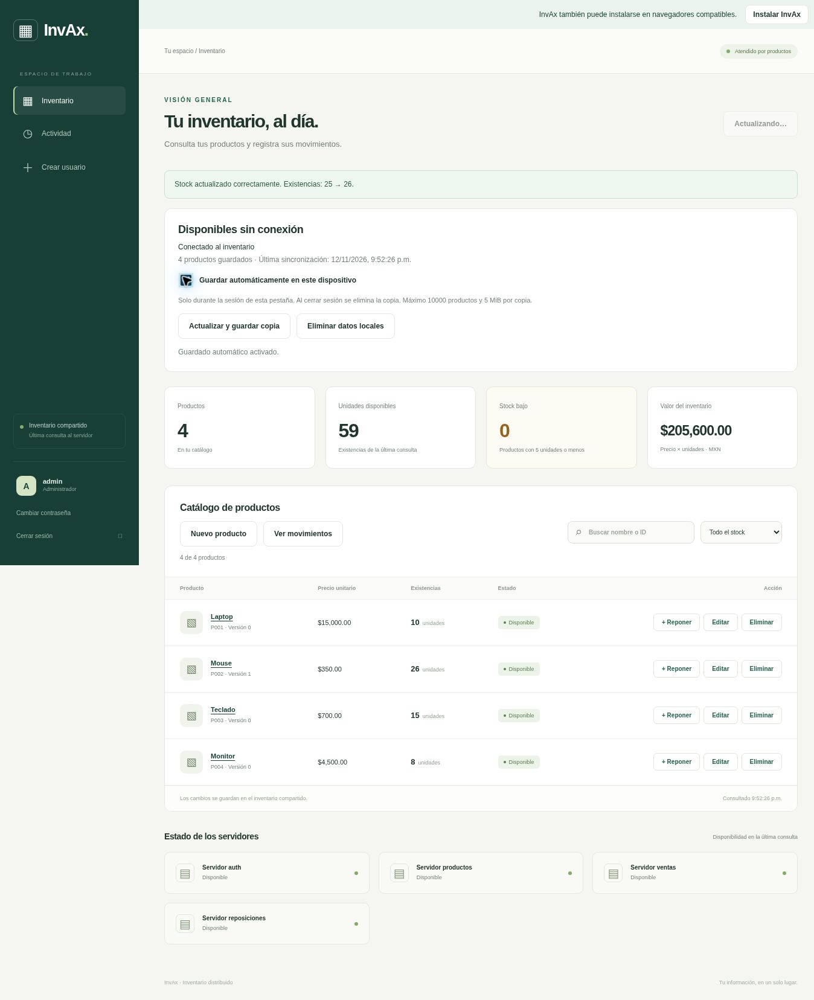
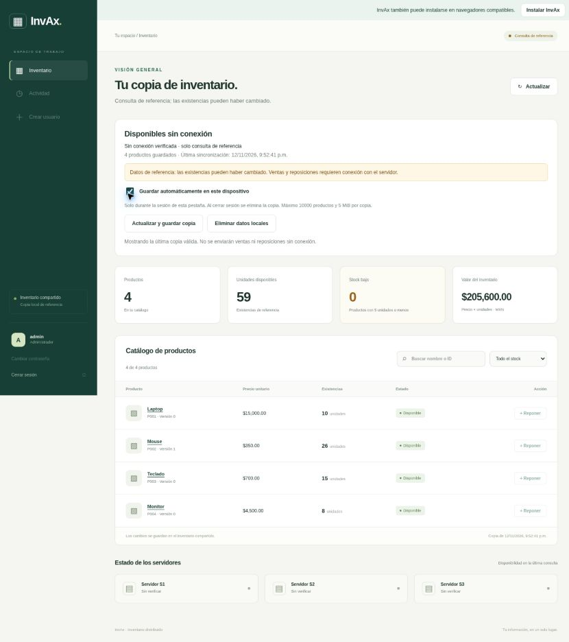

# Evidencias verificables · InvAx P08

## Resultados obtenidos en esta entrega

| Comprobación | Resultado observado |
| --- | --- |
| `pytest tests -q` con PostgreSQL 17.11 temporal, TLS y cinco procesos HTTP separados | **66 passed, 37 subtests passed in 17.45s** |
| `npm test --prefix tests/frontend` | **10 passed, 0 failed** |
| `node --check` de todos los JS del frontend | Sin errores |
| `python scripts/preparar_pwa.py --check` | `invax-shell-4de92672df46174d` |
| `git diff --check` | Sin errores |
| Comparación del Dockerfile y render.yaml legacy con el commit base | Sin cambios |
| Navegador con PostgreSQL desechable y servicios independientes | Alta, edición y eliminación de producto QA; reposición e historial; copia consultable tras detener servidor |
| Construcción Docker / Compose en ejecución | **Pendiente**: Docker no está disponible en el entorno de implementación |
| GitHub Actions en el repositorio remoto | **Pendiente**: workflow preparado, no publicado/ejecutado por esta entrega |
| Supabase real y Render P08 | **Pendiente**: sin migración ni acceso a secretos de producción |

Los 37 subtests son parte de los tests Python; no deben sumarse como suites independientes. Las pruebas P08 de integración utilizan PostgreSQL real desechable y no SQLite. Algunos tests heredados conservan su mecanismo anterior para verificar compatibilidad legacy. Los procesos de integración se sirven con WSGI de pruebas; Gunicorn está configurado para la ejecución Docker, no se afirma haber ejecutado contenedores.

### Capturas de QA

Datos ficticios, aislados de Supabase y Render. No convertir estas capturas en evidencia de un despliegue remoto propio.





Se creó P020 sin stock, se editó y eliminó desde el diálogo. Se repuso P002 de 25 a 26 y se comprobó su historial. Se activó el guardado de copia, se detuvo el servidor y se recargó: quedaron cuatro productos consultables y las reposiciones deshabilitadas. El entorno de QA y sus rutas de sesión sintética **no forman parte del código entregado**.

## Repetir las pruebas automatizadas

```bash
python -m pip install -r requirements-dev.txt
pytest tests -q
npm ci --prefix tests/frontend
npm test --prefix tests/frontend
python scripts/preparar_pwa.py --check
```

Sin `INVAX_TEST_DATABASE_URL` los tests que necesitan PostgreSQL se omiten explícitamente: eso no prueba la integración completa. Para incluirlos, configurar esa variable privadamente con una base **desechable `invax_test*`**, TLS habilitado y usuario administrador de esa base capaz de crear roles. El fixture aplica el esquema y reinicia los datos de prueba. Nunca apuntar a la base del inventario escolar. Usar una instancia PostgreSQL aislada también evita colisiones con roles homónimos de otros entornos.

El workflow `.github/workflows/practica08.yml` provisiona PostgreSQL 17 desechable, configura su TLS, ejecuta Python/PWA, valida Compose y construye la imagen. Después de subir el código, capturar el resultado real de Actions; si falla, conservar el mensaje y corregirlo antes de declarar aprobada la CI.

## Capturas que debe tomar el alumno al desplegar

| Tema | Procedimiento | Fragmento que explica la implementación |
| --- | --- | --- |
| Separación de procesos | Render: cinco servicios nuevos con sus nombres; o `compose ... ps` mostrando cinco contenedores | `backend/microservices/app.py`, `run.py`, `compose.microservices.yaml` |
| Gateway y HTTP | Abrir frontend del Gateway y verificar `microservicios: true` en salud; diagnóstico autenticado | `backend/microservices/gateway.py`, `backend/app.py` |
| Validación de sesión | Acceso protegido sin Bearer → 401; login y sesión propia → 200 | `services.py:create_auth`, `seguridad.py`, `servicio_remoto.py` |
| Permisos de vendedor | Intentar reposición como vendedor → **403** desde API | `services.py:create_movements`, `stores.py:move` |
| Catálogo CRUD | Administrador: alta P005 sin stock, edición, versión y eliminación antes de movimientos | `frontend/product-admin.js`, `stores.py` |
| Venta | Capturar stock antes y después usando cuenta vendedor y cantidad válida | `services.py:create_movements`, `stores.py:move` |
| Reposición | Administrador: capturar stock antes/después e historial | Mismos módulos; acción `agregar_stock` |
| Idempotencia | Test con mismo UUID dos veces: un cambio, una operación y una auditoría | `test_integration.py:test_sales_replenishments_ledger_trace_and_audit` |
| Concurrencia | Test de seis ventas contra stock limitado y seis peticiones del mismo UUID | `test_integration.py:test_real_postgres_concurrent_sales_and_same_uuid` |
| Fallo parcial | Detener solo ventas; catálogo sigue 200 y venta responde 503; reiniciar | `test_individual_failure_leaves_catalog_running`, `common.py:HttpClient` |
| Mínimos privilegios | Test confirma que auth no accede al catálogo y productos no accede a usuarios | `test_database_permissions_are_enforced`, `database/02_microservices.sql` |
| PWA | Guardar copia, desconectar, recargar y demostrar consultas con acciones bloqueadas | `frontend/sw.js`, `offline-store.js`, `pwa.js`, `app.js` |
| CI y Docker | Actions completado y resultados reales; Compose ps si se ejecuta | `.github/workflows/practica08.yml`, Dockerfile nuevo |

En el reporte, explicar HMAC como autenticación real. No etiquetar un token propio como JWT ni declarar que el frontend llama a `/api/v1/`.

## Comprobar API sin mostrar tokens completos

El asistente pide la contraseña con entrada oculta, conserva el Bearer en memoria y no lo imprime:

```bash
python scripts/evidencias_p08.py https://URL-REAL-DEL-GATEWAY
```

Sustituir por la URL efectiva del panel. Con vendedor, la prueba opcional de reposición debe devolver 403 sin modificar stock. Con administrador, el asistente no ejecuta esa escritura. Solo imprime sesión reducida, datos de catálogo, diagnóstico e historial; revisar los datos de negocio antes de compartirlos.

Comprobaciones públicas seguras, sin secretos:

```bash
curl -i https://URL-REAL-DEL-GATEWAY/api/health
curl -i https://URL-REAL-DEL-GATEWAY/api/salud
curl -i https://URL-REAL-DEL-GATEWAY/api/productos
curl -i -X POST https://URL-REAL-DE-PRODUCTOS/internal/rpc -H 'Content-Type: application/json' --data '{"method":"ping","args":[]}'
```

Esperados: 200, 200 con microservicios true, 401 sin sesión y 401 sin credencial interna. Un 200 de health es solo vida del proceso; no demuestra conexión SQL ni permisos de negocio.

## Fallo controlado y trazas con Compose

Realizarlo en un entorno de prueba sin usuarios trabajando:

```bash
docker compose --env-file .env.microservices -f compose.microservices.yaml stop ventas
```

Comprobar catálogo con sesión válida y observar error al vender. Luego:

```bash
docker compose --env-file .env.microservices -f compose.microservices.yaml start ventas
docker compose --env-file .env.microservices -f compose.microservices.yaml logs --tail=100 gateway ventas productos auth
```

La traza aparece en los logs JSON como `request_id`, `origen`, `destino`, `operacion` y `estado`. Buscar el mismo X-Request-ID entre Gateway → ventas → productos y consultas a auth. El request_id del cuerpo identifica el movimiento durable; X-Request-ID identifica una solicitud HTTP. Las comprobaciones automáticas verifican tanto la cabecera de respuesta como la conservación de traza en el diagnóstico paralelo.

No capturar pantallas de variables, URI con contraseña, contraseñas de roles, respuesta completa del login, pestañas de almacenamiento con Bearer ni cabeceras de clúster. Las credenciales ficticias de tests solo funcionan en la base desechable y no son credenciales de tu aplicación.
