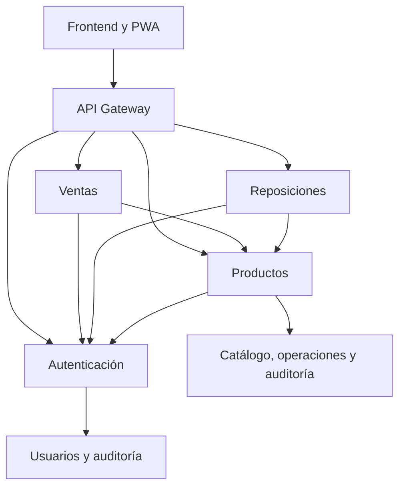

# InvAx · Práctica 08: microservicios

## Estado de la entrega

Implementación preparada sobre el repositorio existente. El despliegue anterior conserva su Dockerfile y `render.yaml`; no se ha migrado la base real ni publicado la nueva arquitectura. Para instalarla en línea, seguir [GUIA_DESPLIEGUE_P08.md](GUIA_DESPLIEGUE_P08.md). Las pruebas usan PostgreSQL temporal con TLS y procesos HTTP independientes, no Supabase de producción.

## Análisis de la versión anterior

El frontend es HTML/CSS/JavaScript sin compilación, servido por Flask. `backend/app.py` expone `/api/`, **no `/api/v1/`**. `backend/conexion.py` conecta la API con tres objetos remotos BaseManager iniciados por `backend/iniciar_servidor.py`. `servicio_remoto.py` concentra autenticación, roles y movimientos; `inventario_postgres.py` implementa persistencia transaccional. Gunicorn sirve HTTP y el despliegue original corre todo dentro de una instancia Docker.

La autenticación existente utiliza PBKDF2 y **tokens propios firmados con HMAC, no JWT**. Se conserva su formato y su secreto para evitar una migración de sesiones no solicitada. No se añade una biblioteca JWT ni se declara validación JWT en las evidencias: lo demostrado es validación de firma, caducidad, cuenta activa y rol mediante el sistema real.

La base existente contiene `productos`, `usuarios`, `operaciones` y `auditoria`. El catálogo usa ID, precio, cantidad y versión. Las ventas y reposiciones ya quedaban en `operaciones` como solicitud/respuesta JSON con UUID único. Se reutilizan estas tablas; no se inventan tablas de ventas o reposiciones incompatibles. El catálogo CRUD y los historiales visibles son ampliaciones de P08: P07 consultaba productos y registraba movimientos, pero no tenía ese CRUD completo.

P07 aporta manifest, iconos, instalación, Service Worker y catálogo validado en IndexedDB. Se mantienen caché exclusiva del shell, API sin caché, copia por sesión y operaciones de escritura solo con servidor disponible.

## Arquitectura nueva

Cada servicio construye una sola aplicación Flask en un proceso Gunicorn separado. No inicia BaseManager. Comparten código e imagen para evitar duplicación, pero sus procesos, variables, permisos, ciclos de despliegue y fallos son independientes. `INVAX_SERVICE` selecciona una aplicación; no arranca las otras cuatro.

| Unidad | Responsabilidad | Acceso PostgreSQL |
| --- | --- | --- |
| gateway | REST público, frontend, enrutamiento fijo, diagnósticos | Ninguno |
| auth | Firma/verificación de sesión, usuarios, contraseñas y consulta de auditoría | Rol `invax_auth`: usuarios SELECT/INSERT/UPDATE; auditoría SELECT/INSERT |
| productos | Catálogo CRUD, stock atómico, registro durable e historial | Rol `invax_productos`: productos CRUD; operaciones SELECT/INSERT; auditoría INSERT |
| ventas | Autorizar vendedor, validar y coordinar venta por HTTP | Ninguno |
| reposiciones | Autorizar administrador, validar y coordinar reposición por HTTP | Ninguno |

Una instancia PostgreSQL compartida es una transición deliberada, con propiedad lógica y permisos SQL separados. Solo productos escribe stock y el registro de movimientos. El historial pertenece al mismo agregado transaccional; ventas/reposiciones consultan ese historial por HTTP. No son cinco bases aisladas ni un protocolo de confirmación distribuida.

## API pública del Gateway

Todas las operaciones de negocio requieren `Authorization: Bearer …`; login y comprobaciones públicas se indican aparte. Los identificadores siguen el formato `P001`. Los cuerpos son JSON.

| Método y ruta | Permiso / contrato |
| --- | --- |
| GET `/`, `/assets/*`, `/sw.js`, `/manifest.webmanifest` | Interfaz y shell PWA públicos |
| GET `/api/health` | Vida HTTP del proceso, sin validar dependencias |
| GET `/api/salud` | Incluye `microservicios: true` y `etapa: 8` en el Gateway nuevo |
| GET `/api/listo` | Comprueba lectura de productos; 503 si falla |
| POST `/api/login` | Público; `{usuario, clave}` |
| GET `/api/sesion` | Sesión vigente y rol |
| GET `/api/productos` | Ambos roles; catálogo e integridad SHA-256 para copia PWA |
| GET `/api/productos/P005` | Ambos roles; consulta individual |
| POST `/api/productos` | Administrador; `{id, nombre, precio, cantidad}`; cantidad inicial opcional, 0 por defecto |
| PUT/PATCH `/api/productos/P005` | Administrador; `{nombre?, precio?, version}`; no modifica cantidad |
| DELETE `/api/productos/P005` | Administrador; cuerpo `{version}`; solo sin stock ni historial |
| POST `/api/ventas` | Vendedor; `{id_producto, cantidad, request_id}` |
| POST `/api/reposiciones` | Administrador; mismo contrato de movimiento |
| GET `/api/ventas?limite=50` | Vendedor ve las propias; administrador ve todas |
| GET `/api/reposiciones?limite=50` | Administrador; límite de 1 a 100 |
| POST `/api/usuarios` | Administrador; `{usuario, clave, rol}` |
| PUT `/api/clave` | Sesión propia; `{clave_actual, clave_nueva}` |
| GET `/api/auditoria` | Administrador; contrato anterior conservado |
| GET `/api/servidores` | Sesión válida; diagnóstico paralelo de auth/productos/ventas/reposiciones |

201 significa alta de producto/usuario; 400 solicitud/cantidad/UUID inválidos; 401 sesión o credencial interna inválida; 403 rol insuficiente; 404 producto/método inexistente; 409 conflicto de versión, duplicado o stock; 422 metadatos inválidos; 500 error interno sanitizado; 503 dependencia/persistencia no disponible. Un producto ausente en una solicitud de movimiento queda como resultado rechazado durable con 409; la consulta individual devuelve 404.

## RPC HTTP y seguridad

Los cuatro servicios de negocio exponen solo `GET /api/health` público y `POST /internal/rpc` protegido. El cuerpo RPC es exactamente `{ "method": "nombre_publicado", "args": [] }`. Se publica una lista explícita de funciones y se valida la aridad, sin invocación arbitraria de métodos Python. El Gateway nunca acepta un destino URL elegido por el navegador.

`X-Cluster-Token` debe coincidir en todos los servicios y tener al menos 32 caracteres. No llega al frontend. Toda operación de negocio vuelve a comprobar el token del usuario mediante auth; productos vuelve a comprobar el rol antes de modificar stock. `X-Role` no concede permisos. El secreto HMAC de sesiones solo lo posee auth. No se comparten URLs de base de datos con gateway, ventas o reposiciones.

El cliente HTTP usa tiempos de conexión/respuesta, límite de respuesta, destinos fijos, no sigue redirecciones ni reintenta automáticamente escrituras. La traza `X-Request-ID` se valida y propaga por la cadena y por el diagnóstico paralelo. Los logs JSON muestran origen, destino, operación, estado y duración; omiten contraseñas, tokens, cabeceras completas y SQL. Un UUID de traza no es el UUID de idempotencia.

El mismo origen sirve frontend y API, por lo que CORS queda cerrado por defecto. `INVAX_ALLOWED_ORIGINS` permite una lista explícita si se necesita; `*` se rechaza. La política CSP del frontend continúa restringiendo conexiones al propio origen. CORS no sustituye la autenticación.

HTTPS se utiliza entre servicios en Render y para el navegador. Compose usa HTTP en su red interna y solo publica el Gateway en localhost. La conexión PostgreSQL exige TLS `sslmode=require` como en P07; cifra el canal, pero no verifica la identidad del servidor como lo haría `verify-full` con su CA configurada.

## Consistencia, concurrencia e idempotencia

1. Ventas/reposiciones autorizan y validan cantidad entera de 1 a 10000 y UUID.
2. Productos vuelve a autorizar y abre una transacción PostgreSQL.
3. Toma bloqueo asesor del UUID y busca una operación previa. Si coincide actor y solicitud completa, devuelve su respuesta guardada; si cambió el contenido, responde 409.
4. Bloquea la fila del producto con `FOR UPDATE`. Comprueba stock y calcula el nuevo valor dentro del bloqueo, evitando consultar y descontar en llamadas separadas.
5. Confirma stock, respuesta durable y auditoría en la misma transacción. Una repetición no inserta otra auditoría ni modifica de nuevo stock.

Si una respuesta se pierde después del commit, se reenvía **el mismo UUID y contenido** para recuperar el resultado. Los rechazos de negocio también se guardan: para una nueva intención se usa un UUID nuevo. No hay cola offline, reservas parciales ni transacciones de dos fases. La edición de metadatos y eliminación usan `version` para detectar cambios concurrentes. La eliminación exige stock cero y ausencia de historial.

La caída de ventas permite seguir consultando catálogo y reponiendo si sus dependencias están disponibles. La de reposiciones no impide catálogo/ventas. La de auth bloquea operaciones autenticadas; la de productos bloquea operaciones de inventario. Separar servicios no elimina estas dependencias.

## Frontend y PWA

El navegador sigue llamando solo a rutas relativas `/api/` del Gateway. `/api/salud` activa los controles de P08; el despliegue legacy no los muestra. El administrador dispone de alta/edición/eliminación y de historial. Los vendedores conservan sus ventas y consultan su historial. Los permisos siempre se validan en servidor.

Se añade `product-admin.js` al shell y se deriva nuevamente la versión del Service Worker con `scripts/preparar_pwa.py`. Se conserva IndexedDB, validación de integridad, límite de copia, limpieza al cerrar sesión y recuperación sin conexión. El tiempo de espera de las solicitudes del frontend pasa de 12 a 30 segundos para las llamadas encadenadas; no garantiza que un arranque en frío de Render termine a tiempo. El shell cargado desde caché no demuestra que el backend esté listo.

## Ejecución y despliegue

Ver [GUIA_DESPLIEGUE_P08.md](GUIA_DESPLIEGUE_P08.md) para roles PostgreSQL, secretos, Compose y los cinco servicios de Render. `database/02_microservices.sql` es aditiva y conserva los datos. No ejecutar los tests de integración sobre la base escolar real.

## Verificación

El detalle reproducible está en [EVIDENCIAS_P08.md](EVIDENCIAS_P08.md). Se probaron procesos HTTP independientes con PostgreSQL 17 temporal y TLS, concurrencia real, mínimos privilegios, caída/reinicio individual, autenticación y PWA. Los tests requieren una base desechable llamada `invax_test*`; sin esa variable se omiten explícitamente los de integración.

Las capturas de `docs/qa-p08/` corresponden al entorno desechable de QA y datos ficticios. No son evidencia de despliegue en Render. Docker Compose, la construcción Docker, el workflow en GitHub y la migración en Supabase real quedan pendientes de ejecución en sus entornos respectivos. La CI entregada prepara esas verificaciones; su existencia no implica que ya haya pasado.
